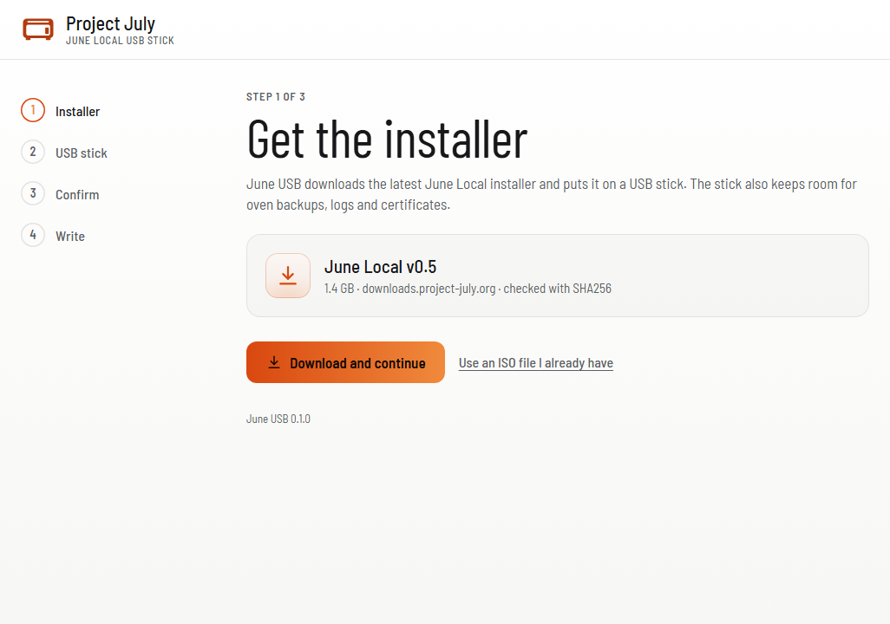
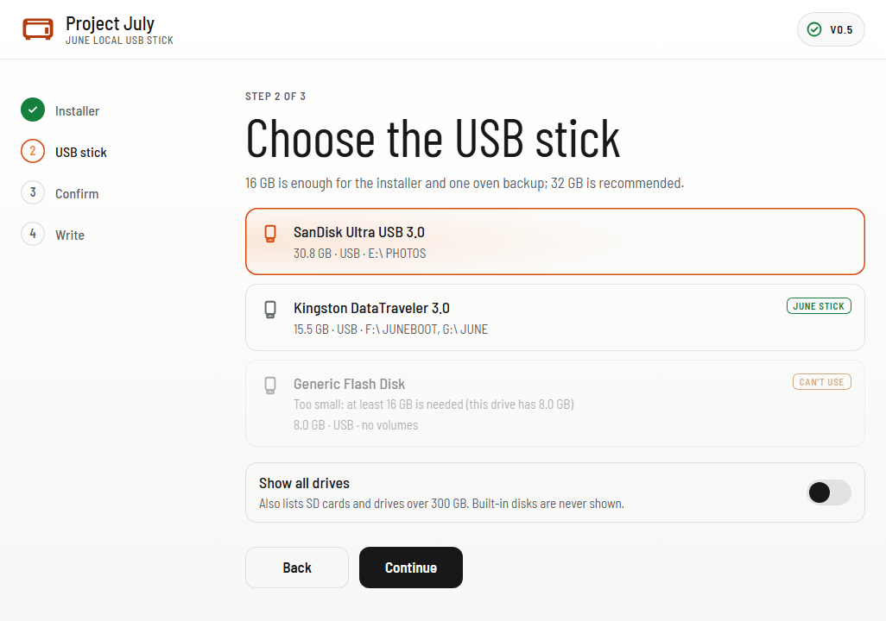
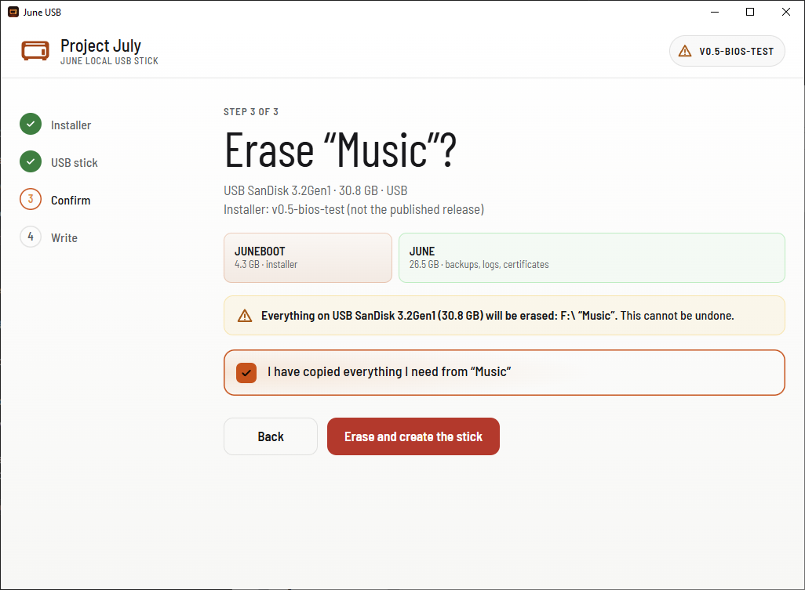
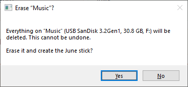
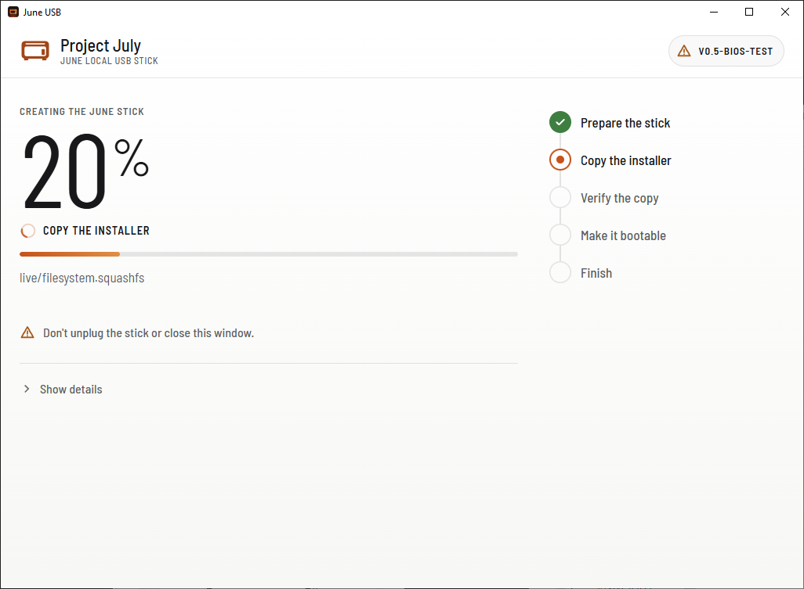
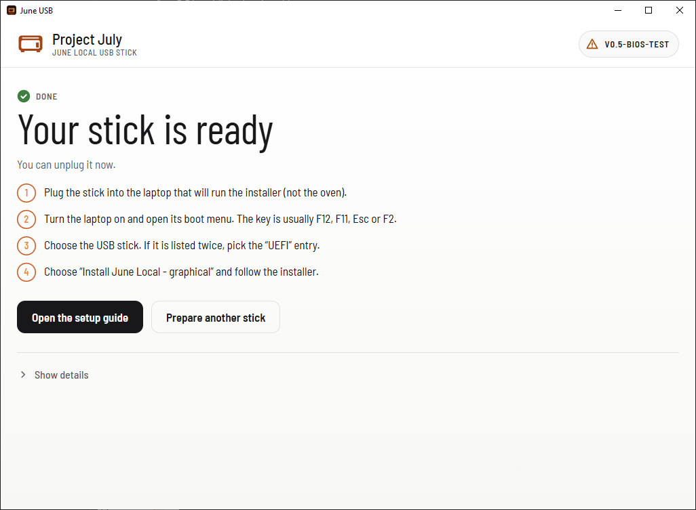

# Creating the June Local USB stick

The June Local installer runs on a laptop, started from a USB stick. This page
covers the three ways to make that stick:

1. **[June USB](#june-usb-recommended)** (recommended): a small Windows/Mac app
   that downloads the installer, checks it and prepares the stick in one go.
2. **[Ventoy](#ventoy)**: the older way, and the way to make the stick on Linux.
3. **[The installer image on its own](#the-installer-image-on-its-own)**: for
   other tools, or if you want to check every step yourself.

## What you need

- A USB stick of **16 GB or more**; 32 GB is recommended. The installer takes
  4 GB, and one oven backup is about 7.3 GB. USB 3 is noticeably faster.
- A Windows 10/11 PC or a Mac with macOS 13 (Ventura) or later to make the stick, and a laptop to start the
  installer on (it can be the same computer). The installer needs an Intel or
  AMD laptop: Macs with Apple chips and Windows laptops with ARM (Snapdragon)
  processors, such as the Surface Pro 9 with 5G or the Surface Pro X, can make
  the stick but can't start the installer.
- **Making the stick erases it.** Copy anything you need off it first.

## June USB (recommended)

Download June USB for
[Windows](https://downloads.project-july.org/june-usb/June-USB.exe) or
[Mac](https://downloads.project-july.org/june-usb/June-USB.dmg) and start it.
On Windows it asks for administrator permission, which it needs to partition
the stick. It needs no installation and no Ventoy.

> **Windows:** June USB is signed by its publisher, Felix Nenz. While the
> release is new, Windows may still show "Windows protected your PC": choose
> **More info**, check that it says **Publisher: Felix Nenz**, then **Run
> anyway**. If it names another publisher or none, don't run it.
>
> **Mac:** the Mac version isn't signed yet. Open the disk image, drag June USB
> to Applications and open it; when macOS refuses, go to **System Settings →
> Privacy & Security** and choose **Open Anyway**. The Mac version is new and
> less tested than the Windows one; if it gives you trouble, use Ventoy on
> another computer for now.

### 1. Get the installer

June USB checks the download site for the current installer. Press
**Download and continue**: it downloads `june-local-live.iso` (about 1.4 GB)
and checks its SHA-256 itself, so there's nothing to verify by hand. A copy it
downloaded before is reused, and a download that stopped continues where it
left off.

The latest version is preselected. If it gives you trouble, **Older versions**
offers the two before it.



**Use an ISO file I already have** takes an image you downloaded yourself.
June USB checks it against the published release; one that doesn't match (an
older or test build) is marked "not the published release" but can still be used.

### 2. Choose the USB stick

Plug the stick in. It appears within a few seconds, with its size and current
drive letters and names. Sticks under 16 GB are shown as **Can't use**, and a
stick made with June USB before is marked **June stick**. **Show all drives**
also lists SD cards and drives over 300 GB. Built-in disks are never listed.



### 3. Confirm

June USB names the stick it is about to erase, by its own name, and lists what
is on it. Tick **I have copied everything I need from “…”** and press **Erase
and create the stick**. Windows or macOS then asks once more, in a system dialog
that names the stick again; it only continues if you say **Yes**.





### 4. Wait for it to finish

June USB partitions the stick, copies the installer, reads every file back to
check it, and makes the stick bootable. This takes a few minutes. Don't unplug
the stick or close the window while it runs.



### 5. Done

June USB writes everything out and ejects the stick, so you can unplug it
straight away. If something on the computer still had the stick open, it says
so; then use **Eject** in File Explorer or Finder before unplugging.



(The screenshots of steps 3–5 are from a test build, hence the "v0.5-bios-test"
in the top corner. A normal download shows the version with a green check.)

### Updating the stick later

Run June USB again with the stick plugged in. It recognises a June stick and
suggests **Update the installer**: that replaces only the installer and keeps
everything on `JUNE`, including oven backups. **Erase and start fresh** wipes
the whole stick instead.

### What's on the stick

| Part | Size | Format | Name | Contents |
|---|---|---|---|---|
| 1 | 4 GB | FAT32 | `JUNEBOOT` | The installer. Leave it alone. |
| 2 | the rest | exFAT | `JUNE` | Oven backups, `june-logs/` and `june-certs/`. |

Keep the names. The installer finds the stick by them to save logs,
certificates and backups.

### Starting the laptop from a June USB stick

Plug the stick into the laptop that will run the installer (not the oven),
switch it on and press its boot-menu key straight away (often F12, F11, F9, F2 or
Esc). Pick the USB stick; if it's listed twice, pick the **UEFI** entry. You get
one menu, the June Local menu, which starts the graphical installer by itself.

- **Secure Boot** can stay on. There's no key to enroll. Surface devices and
  some other recent laptops sold as *Secured-core PCs* first need one Secure
  Boot setting changed: see the next section.
- From installer 0.6, the stick also starts on older computers without UEFI
  (legacy BIOS). With 0.5 it needs UEFI, which every laptop from the last ten
  years or so has.

Then follow [`USE_LIVE_INSTALLER.md`](USE_LIVE_INSTALLER.md).

### Surface and other Secured-core laptops

The installer is Debian Linux. It starts with Secure Boot on through a loader
signed with Microsoft's third-party certificate, which almost every PC trusts.
Laptops sold as *Secured-core PCs*, including the Surface Pro 8 and later and
the Surface Laptop 4 and later, come trusting only Windows itself: they skip
the stick or say it isn't bootable. On a Surface:

1. Shut it down. Hold **Volume Up** and press the power button until the
   Surface UEFI screen appears.
2. **Security** → **Secure Boot** → **Change configuration**: choose
   **Microsoft & 3rd party CA** and press **OK**. Secure Boot stays on.
3. **Exit** → **Restart now**, and hold **Volume Down** while it starts until
   the June Local menu appears.

Other Secured-core laptops (several Lenovo ThinkPads from 2022 on, for example)
have the same switch in their firmware settings, usually called *Allow
Microsoft 3rd Party UEFI CA*. Windows starts normally with either setting; you
can switch it back when you're done.

A Surface Pro 9 **with 5G**, and every Surface Pro X, has an ARM processor
instead of an Intel one. It can't start the installer, however the stick is
made (Ventoy too); use another laptop.

> **Installer 0.5 and June USB sticks.** Installer 0.5 only recognises Ventoy
> sticks as the boot stick. Started from a June USB stick, 0.5 installs and
> restores normally, but doesn't offer the stick itself for backups, logs and
> certificates; plug in a second USB drive for those. Installer 0.6 recognises
> both kinds.

## Ventoy

Ventoy turns a stick into a boot menu that starts the ISO file copied onto it.
It works on Windows and Linux (not Mac) and is the way to make the stick on
Linux. The full recipe is in [`CREATE_VENTOY_USB.md`](CREATE_VENTOY_USB.md):
install Ventoy, copy `june-local-live.iso` and `ventoy/ventoy.json` onto the
`Ventoy` partition, and enroll Ventoy's Secure Boot key on first start.

A Ventoy stick shows two menus, Ventoy's and then June Local's, and keeps its
oven backups on the `Ventoy` partition.

## The installer image on its own

The installer is a single file, `june-local-live.iso`. The current release is
always at <https://downloads.project-july.org/installer/latest>. Each version
has its own URL (e.g. `…/installer/v0.8/june-local-live.iso`). Its SHA-256 is on
the website and in <https://downloads.project-july.org/installer/latest.json>,
which June USB reads. Check it before use:

```powershell
Get-FileHash .\june-local-live.iso -Algorithm SHA256
```

```sh
sha256sum june-local-live.iso
```

You need the file itself for Ventoy and for June USB's **Use an ISO file I
already have**. Writing it directly to a stick with a tool like Rufus,
balenaEtcher or `dd` also gives a stick that starts the installer, but the
whole stick becomes read-only: backups, logs and certificates then need a
second USB drive.

## On Linux, from the command line

June USB's command-line version, `june-usb-cli`, does the same as the app on
Linux (as root, with `dosfstools`, `exfatprogs` and `util-linux`). There's no
prebuilt download yet; build it from `installer/usbtool`:

```sh
cd installer/usbtool && go build ./cmd/june-usb-cli
sudo ./june-usb-cli -list                 # find the stick
sudo ./june-usb-cli -device /dev/sdX      # download, erase, write, verify
sudo ./june-usb-cli -device /dev/sdX -update   # replace only the installer
```

## Troubleshooting

| Symptom | Fix |
|---|---|
| The stick isn't listed in June USB | Wait a few seconds after plugging it in, try another USB port, or switch on **Show all drives** (card readers and some USB enclosures). Sticks under 16 GB are listed as **Can't use**. |
| "Could not check for the latest release" | No internet, or the download site is unreachable. Try again, or use **Use an ISO file I already have**. |
| "The downloaded file is damaged" | The download was corrupted. Try again; June USB never writes an image that fails its check. |
| "Does not match the ISO; the stick may be faulty" | A file read back differently from what was written. Try another stick; fake-capacity sticks fail this way. |
| "Eject it before unplugging" on the last screen | A window or program still had the stick open. Close it and use **Eject** in File Explorer or Finder. The stick itself is complete. |
| The laptop doesn't list the stick in its boot menu | Pick the **UEFI** entry, try another USB port, or check that USB boot is enabled in the firmware settings. |
| A Surface (or another Secured-core laptop) says the stick isn't bootable, or skips it and starts Windows | Set Secure Boot to **Microsoft & 3rd party CA**: see [Surface and other Secured-core laptops](#surface-and-other-secured-core-laptops). ARM laptops (Surface Pro 9 with 5G, Surface Pro X) can't start the installer; use another laptop. |

How the app works, how to build it and how it's released:
[`installer/usbtool/README.md`](installer/usbtool/README.md).
